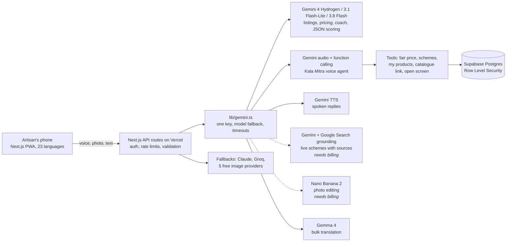

# KalaSetu

KalaSetu helps traditional Indian artisans sell their work online from a phone, in their own language. An artisan can talk to it in Telugu or Hindi, get a fair price for a saree, a studio-style product photo, a listing and a WhatsApp catalogue, and find the government schemes meant for them.

Live: **https://kalasetu-six.vercel.app** (redirects to kalasetu-art.vercel.app)

The same codebase also runs a second brand, Hastkatha; see "Multi-brand deployment" below.

## For judges: try it in 3 minutes

1. **Talk to Kala Mitra** (home screen, or `/voice`). Tap the mic and ask, in any Indian language: "My saree's materials cost 1500 rupees and took 20 hours. What should I charge?" Gemini hears the audio, calls the pricing tool and answers aloud. Then try "Are there schemes for weavers?" and "Open the photoshoot".
2. **Photoshoot** (`/studio`). Upload a phone photo of a product. Gemini studies the photo and writes a precise brief for the image model, so the result shows that product rather than a generic one. (On this free-tier deployment the image itself comes from a free image model; with billing on, Nano Banana edits the real photo.)
3. **Catalogue** (`/catalogue`). Pick a language such as Telugu: the headings and every product name and description come out in that language, ready to share on WhatsApp or download as PDF, PowerPoint or Word.
4. Switch the language from the header: every screen is translated into all 23 of India's scheduled languages plus English.

## Architecture



Dotted lines are built and tested but switched off on this deployment, which runs on the free Gemini API tier (no image or Search-grounding quota); they turn on by themselves once billing is enabled on the API project. Everything else runs live today.

Every AI call goes through one server-only module and has a fallback, so an outage or quota limit never reaches the artisan as an error. Tools the voice agent can call only read the signed-in artisan's own data or public listings; prices always come from a deterministic calculator, never from the model.

## Chosen vertical

**Societal Benefit.** India has millions of traditional artisans (weavers, potters, metal and wood workers) whose skill is world class but whose income depends on middlemen, because selling online needs things most of them don't have: product photos, written listings in English, a storefront, and knowledge of the government schemes meant for them. KalaSetu is an assistant that gives an artisan those things from a phone, in their own language.

## Approach and logic

The assistant adapts to who the user is and what they are doing, rather than offering one generic chat box:

- **Language first.** The artisan picks one of 23 languages on first visit. Every screen, every AI answer (`/api/ai` adds "respond only in <language>" to the prompt), every community story and every blog post is served in that language. Stories are judged in the language they were written in, never translated first.
- **Task-aware AI.** `/api/ai` takes a `mode` (`description`, `craft_story`, `caption`, `pricing`, `whatsapp`) and switches the system prompt to match. A pricing question always factors in labour time; a WhatsApp message stays 2-4 lines; a craft story is told not to invent biographical facts.
- **Gated publishing.** A community story is scored on seven dimensions by AI on the server. It is published only if the overall score is 8 or more; otherwise the artisan gets one specific suggestion to improve it. The browser never supplies a score.
- **Progress that responds to real actions.** Profile completeness, badges, and the Saathi (mentor) referral reward each move forward only when the server confirms the underlying event happened (a saved profile, a first product, a published story).
- **Graceful degradation.** Google Gemini is the primary model for every AI feature. Text falls back from Gemini to Claude to Groq. Image generation starts with Nano Banana and then walks a chain of five more providers. If everything fails, the user gets a plain "try again shortly" message, never a stack trace.

## How it works

1. **Sign up** and choose a language and craft.
2. **Studio / Products:** upload a phone photo, get a studio-quality product shot (the dominant colour is detected in the browser and folded into the prompt) plus an AI description and price guidance.
3. **Catalogue:** publish a shareable public catalogue page; export to PDF, Word or PowerPoint.
4. **Opportunities:** browse government schemes, competitions and trade shows. An admin-reviewed pipeline extracts these from official pages; nothing is auto-published.
5. **Learn / Community / Blog:** short learning modules, artisan stories, and a daily blog, each readable in any of the 23 languages (translations are cached so cost does not grow with traffic).
6. **Saathi:** an established artisan refers a newcomer and is rewarded once the newcomer has both completed a profile and added a first product.

Every API route that spends money (AI, images, payments) checks the Supabase session on the server, is rate limited per user, validates its input, and returns generic error messages.

## Kala Mitra voice agent (new for the Startup Buildathon)

Many artisans can't comfortably read or type, especially in English. **Kala Mitra** (`/voice`, linked from the home screen) lets them just talk, in any of the 23 languages, and have the app do the work.

1. **The artisan taps the mic and speaks.** The browser records the audio and re-encodes it as 16 kHz mono WAV ([`lib/wav.ts`](lib/wav.ts)), so every phone sends a format Gemini accepts.
2. **Gemini listens to the audio directly.** There is no separate speech-to-text step: Gemini hears the question, writes down what it heard in the artisan's own script, and decides what to do.
3. **Gemini function calling runs real tools** ([`lib/voiceAgent.ts`](lib/voiceAgent.ts)):

   | Tool | What it does |
   |---|---|
   | `suggest_fair_price` | Exact price from material cost and hours worked, using the same maths as the Pricing Calculator ([`lib/fairPrice.ts`](lib/fairPrice.ts)). The model never invents a number. |
   | `find_schemes` | Open government schemes, competitions and trade shows from the admin-approved list |
   | `get_my_products` | The artisan's own products, and which still need a listing |
   | `get_my_profile` | Their public catalogue link, ready to share on WhatsApp |
   | `open_screen` | Opens Photoshoot, Listings, Catalogue, Schemes and other tools, from a fixed list of real pages |

4. **It answers in the artisan's language, on screen and aloud.** The reply is spoken with the phone's own voice when it has one for that language, so speech starts at once. Otherwise **Gemini text-to-speech** reads it, since it can speak Indian languages many phones have no voice for. Tool results appear as cards: a price breakdown with a "do not sell below" floor, scheme links with deadlines, the catalogue link with Copy and WhatsApp buttons, and an Open button for the right tool.

Design choices:

- **Read-only and scoped.** The tools only read the signed-in artisan's own rows, or public scheme listings, and never write. A misheard request can at worst show the wrong screen.
- **Fast first.** The artisan's schemes, profile and products are loaded before Gemini is called, so most questions are answered in one call. The agent starts with Gemini 3.1 Flash-Lite and sends a backup request to the next Flash-Lite model if no reply has come after 3 seconds. Whichever answers first is used. If Gemini has not answered within 9 seconds, Groq takes over with the same tools and facts. In live tests answers took 3 to 11 seconds. At most 4 tool rounds per question.
- **Instant prices.** When a question plainly gives a rupee amount for materials and the hours worked, the fair-price calculator answers at once ([`lib/quickPrice.ts`](lib/quickPrice.ts)), in 1 to 2 seconds. Typed questions are read directly. Spoken ones are written down by Whisper while Gemini starts on the audio, and whichever is ready first is used. Anything less clear (a wage, a per-hour rate, extra numbers) goes to the agent as usual.
- **Skips Gemini while it is down.** After 2 Gemini failures in a row, Groq answers first for the next 2 minutes instead of every artisan waiting 9 seconds.
- **Phone voice first.** When the phone has a voice for the chosen language, the reply is spoken right away. Gemini text-to-speech is used only for languages the phone can't speak.
- **Accuracy check.** `npx tsx scripts/evalVoiceAgent.mts` asks 30 real questions in 6 languages and checks the price, the cards, the screen opened and the script of the reply. On Gemini alone it scored 25/30, and most misses were busy-server errors that the Groq fallback now covers.
- **Typing always works too**, for anyone who can't or would rather not speak, and silence is caught before an AI call is spent on it.
- **Tested.** `tests/voiceAgent.test.ts` covers the pricing maths, WAV encoding, the full function-calling loop (including passing Gemini's thought signatures back), tool failures, model fallback, filter-injection-safe scheme search, per-user data scoping, and both API routes.

## Google AI integration

All AI goes through one server-only module, [`lib/gemini.ts`](lib/gemini.ts), which calls the Gemini API with a single key. Each feature uses Google first and keeps the older providers only as automatic fallbacks.

| Feature | Google model | Where | Fallback |
|---|---|---|---|
| Photoshoot and design art direction | **Gemini** (`gemini-3.1-flash-lite`, vision) studies the artisan's real photo, or the design brief, and writes a precise image prompt: exact shape, material, colours, motifs, or for designs named motifs, a colour palette and craft-true details. The free image models then render something close to the real product instead of a generic one | `lib/artDirector.ts`, `/api/photoshoot`, `/api/design-image` | The original template prompt |
| AI Photoshoot | **Nano Banana 2** (`gemini-3.1-flash-image`) edits the artisan's real phone photo into a studio, heritage or festival scene and is told to keep the product itself unchanged | `lib/imageProviders.ts`, `/api/photoshoot` | Hugging Face, Cloudflare, Pixazo, Stability, Pollinations |
| Design Studio images | **Nano Banana** | `/api/design-image` | same chain |
| Listings, craft story, captions, WhatsApp and Facebook posts, B2B catalogue entries | **Gemini 4 Hydrogen** (`gemini-4-hydrogen`), multimodal, so a product photo can be sent with the request | `/api/ai` | Claude, then Groq |
| Pricing Assistant and Business Coach | **Gemini**, answering in the artisan's chosen language | `/api/ai` (`pricing`, `coach` modes) | Claude, then Groq |
| Design inspiration | **Gemini** with JSON output | `/api/ai` (`design_inspiration`) | Claude, then Groq |
| Story quality gate (7 scores) | **Gemini** with JSON output, validated on the server before a story can publish | `lib/storyEvaluator.ts` | Claude, then Groq |
| Live scheme answers | **Gemini with Google Search grounding** answers "what's new for weavers in Telangana?" with links to its sources, inside the voice agent | `lib/gemini.ts` (`geminiGrounded`), `lib/voiceAgent.ts` | The admin-approved scheme list |
| Government Scheme Navigator | **Gemini** with JSON output reads official scheme pages and extracts title, type and deadline for admin review | `/api/admin/scrape-schemes`, scheme cron | Claude, then Groq |
| Story translation | **Gemini** | `/api/story-translate` | Claude, then Groq |
| Kala Mitra voice agent | **Gemini** audio understanding and function calling, plus **Gemini TTS** (`gemini-3.8-flash-tts`) for spoken replies | `/api/voice-agent`, `/api/speak` | Next Gemini model; the phone's own voice for speech |
| Bulk blog translation into 22 languages | **Gemma 4** (`gemma-4-26b-a4b-it`), the low-cost model for high-volume work | `/api/blog-translate`, daily blog cron | Gemini, Claude, Groq |

How the layer works:

- **Several Gemini models before any fallback.** Text requests try Gemini 4 Hydrogen, then Gemini 3.1 Flash-Lite, then Gemini 3.8 Flash, each with a short timeout, so a briefly overloaded model (503) or a rate limit (429) hands over to another Gemini model in seconds. Claude and Groq are only used if every Gemini model fails.
- **One key, three model families.** Gemini, Nano Banana and Gemma all run through the same Gemini API key (`GEMINI_API_KEY`). Model ids can be changed from environment variables (`GEMINI_MODEL`, `GEMINI_IMAGE_MODEL`, `GEMMA_MODEL`) without a code change.
- **Structured output.** Features that need data, not prose (story scores, scheme extraction, design ideas), ask Gemini for JSON, and the server validates it before using it. An invalid answer falls through to the next provider instead of failing the artisan.
- **Quota.** Nano Banana image generation and Google Search grounding need a Gemini API project with billing enabled; on the free tier its quota is zero, until billing is on, the photoshoot uses the fallback image chain and the voice agent answers schemes from the approved list. No code change is needed when billing is turned on.
- **Fails safe.** Every call has a timeout. If Gemini is unavailable, rate limited or not configured, the feature silently uses the fallback provider. Gemini's own error text is logged on the server and never sent to the browser.
- **Tested.** `tests/gemini.test.ts` checks the request sent to Google (system prompt, chat history, image data, JSON mode, model choice), the Nano Banana "keep the product unchanged" instruction, Gemma's fallback to Gemini, and that `/api/ai` and the story evaluator use Gemini first and fall back only when it fails.

## Languages

Every screen an artisan uses is translated into all 23 languages (India's 22 scheduled languages and English), from one dictionary in [`lib/translations.ts`](lib/translations.ts): 822 keys, with every language complete. `tests/translationCoverage.test.ts` fails the build if any language is missing a key, if Urdu, Kashmiri or Sindhi text falls back to Roman letters, or if a login error has no translation. Errors from the server or from Supabase are shown as translated messages, never as raw English (`lib/useAI.ts`, `lib/authErrors.ts`). The admin portal is English only, since it is used by staff.

## Assumptions

- Artisans mostly use a phone, may have patchy connectivity, and are more comfortable in a regional language than in English.
- An AI provider can be down or rate limited at any time, so every AI feature must have a fallback or a clear failure message.
- Rate limiting is per serverless instance (there is no Redis); it is a cost guard, not a hard security boundary. Auth and Row Level Security are the real boundary.
- Prices are in INR and paid through Razorpay; the price charged is always computed on the server from `lib/pricing.ts`.
- Government scheme data is only shown after a human admin approves it.

## Multi-brand deployment

Two Vercel projects deploy this same repo, differing only in the `NEXT_PUBLIC_BRAND` environment variable (`kalasetu` or `hastkatha`) and `NEXT_PUBLIC_APP_URL`:

| Vercel project | `NEXT_PUBLIC_BRAND` | Domain | Renders as |
|---|---|---|---|
| `kalasetu` | `kalasetu` | kalasetu-six.vercel.app | "KalaSetu" |
| `hastkatha` | `hastkatha` | hastkatha.vercel.app | "Hastkatha" |

`lib/brand.ts` reads that env var and exports `BRAND` (name, fallback URL, support email). Every page title, meta tag, JSON-LD entity, AI system prompt, and PWA manifest pulls the brand name from there rather than hardcoding either name, `tests/branding.test.ts` enforces this. `lib/translations.ts` uses a `{{BRAND}}` placeholder, substituted at read time in `getTranslations()`, instead of duplicating every UI string per brand.

The single scheduled cron job (`api/cron/daily`) registers on both projects but only actually runs on the `hastkatha` deployment. See the `BRAND_ID` guard. This is deliberate: both brands share one Supabase database, so running it from both deployments would insert every post and every scraped opportunity twice.

`hello@kalasetu.in` is never used anywhere in this codebase, for either brand. `kalasetu.in` is the live domain of a real, unrelated business, not ours (this project was renamed from KalaSetu to Hastkatha for exactly this reason; see the AI Build Log). Both brands share the one real support address, `hello@hastkatha.in`, until each has its own domain and inbox.

Adding a new custom domain to either brand: `npx vercel domains add <domain>` while linked to the right project (`npx vercel link --project kalasetu` or `--project hastkatha`), then update that project's `NEXT_PUBLIC_APP_URL`.

## Stack

- **Framework:** Next.js 16 (App Router)
- **Database & auth:** Supabase (PostgreSQL, Row Level Security on every table)
- **Hosting:** Vercel, including scheduled cron jobs
- **AI text:** Google Gemini (primary) and Gemma for bulk translation, with automatic fallback to Anthropic Claude and then Groq
- **AI images:** Google Nano Banana (primary), then Hugging Face, Cloudflare Workers AI, Pixazo, Stability AI, and Pollinations, tried in order with automatic fallback
- **Payments:** Razorpay
- **Tests:** Vitest

## Getting started

```bash
npm install --legacy-peer-deps
npm run dev
```

Open [http://localhost:3000](http://localhost:3000). You will need a `.env.local` file. See Environment variables below.

## Environment variables

Set these in `.env.local` for local development, and in the Vercel project settings for production:

| Variable | Purpose |
|---|---|
| `NEXT_PUBLIC_SUPABASE_URL` | Supabase project URL |
| `NEXT_PUBLIC_SUPABASE_ANON_KEY` | Supabase anon key (safe for the browser) |
| `SUPABASE_SERVICE_ROLE_KEY` | Server-only key that bypasses Row Level Security. Never expose to the client. |
| `GEMINI_API_KEY` | Primary AI provider: Gemini, Nano Banana and Gemma (free key from Google AI Studio) |
| `GEMINI_AGENT_MODEL`, `GEMINI_TTS_MODEL` | Optional overrides (comma-separated lists) for the voice agent and its speech. Defaults: `gemini-3.1-flash-lite,gemini-4-hydrogen,gemini-3.8-flash` and `gemini-3.8-flash-tts,gemini-3.8-flash-lite-tts` |
| `GEMINI_MODEL`, `GEMINI_IMAGE_MODEL`, `GEMMA_MODEL` | Optional model overrides. `GEMINI_MODEL` takes a comma-separated list tried in order. Defaults: `gemini-4-hydrogen,gemini-3.1-flash-lite,gemini-3.8-flash`, `gemini-3.1-flash-image`, `gemma-4-26b-a4b-it` |
| `ANTHROPIC_API_KEY` | First fallback AI text provider |
| `GROQ_API_KEY` | Second fallback AI text provider |
| `HF_API_KEY`, `CLOUDFLARE_ACCOUNT_ID`, `CLOUDFLARE_API_TOKEN`, `PIXAZO_API_KEY`, `STABILITY_API_KEY`, `POLLINATIONS_API_TOKEN` | Image generation providers (fallback chain; only configured providers are used) |
| `RAZORPAY_KEY_ID`, `RAZORPAY_KEY_SECRET` | Payments |
| `CRON_SECRET` | Bearer token required by all cron endpoints (the scheduled one and the two directly-callable ones) |
| `NEXT_PUBLIC_APP_URL` | Canonical site URL, used in the sitemap, robots.txt, and structured data |
| `NEXT_PUBLIC_BRAND` | `kalasetu` or `hastkatha`, which picks which brand this deployment renders as. See "Multi-brand deployment" above. |

## Scheduled jobs

`vercel.json` registers exactly one cron entry, `api/cron/daily` (Vercel's Hobby plan allows only one cron job per account). It alternates by day of year: scheme scraping on even days, the blog on odd days, each still gated by `CRON_SECRET` and the `BRAND_ID` guard.

- `api/cron/daily-blog`: writes and publishes one blog post with a header image, then translates it into all supported languages. Still directly callable on its own (same `CRON_SECRET`) for a manual run regardless of the day.
- `api/cron/scrape-schemes`: crawls configured government/scheme sources and publishes new opportunities. Also still directly callable on its own.

## Testing

```bash
npm test
```

Vitest suites in `tests/` cover:

- **API routes:** auth, rate limiting, input validation, provider failure and success paths for `/api/ai`, `/api/photoshoot`, `/api/design-image`, `/api/story-evaluate`, `/api/story-publish`, `/api/story-translate`, `/api/referral`, and both webhook hooks.
- **Payments:** Razorpay order creation charges the server-side price; verification rejects forged or mismatched signatures, unpaid orders, and wrong amounts, and grants the tier recorded on Razorpay's order rather than the one the client claims.
- **Kala Mitra voice agent:** fair-price maths, WAV encoding, the Gemini function-calling loop and its tools, model fallback, and the `/api/voice-agent` and `/api/speak` routes.
- **Google AI layer:** Gemini, Nano Banana and Gemma requests, structured output, timeouts, and Gemini-first behaviour with fallback on every AI route.
- **Core logic:** pricing, KalaWallet balance and atomic redemption, profile completeness, story-score validation, rate limiting, request parsing, and the image-provider fallback chain.
- **Platform:** cron endpoint auth, robots.txt and sitemap, branding, and translation-file integrity across all 23 languages.

CI (`.github/workflows/tests.yml`) runs the suite, a TypeScript typecheck and ESLint on every push and pull request.

## Database migrations

SQL migrations live in `supabase/`, numbered in the order they were applied. Run new migrations against the Supabase project directly; this repo does not run them automatically.

## Deployment

```bash
npx vercel --prod --yes
```

Requires `.npmrc` with `legacy-peer-deps=true` (already committed). Vercel's build will fail without it, due to a peer-dependency conflict introduced by the test suite's dependencies.
